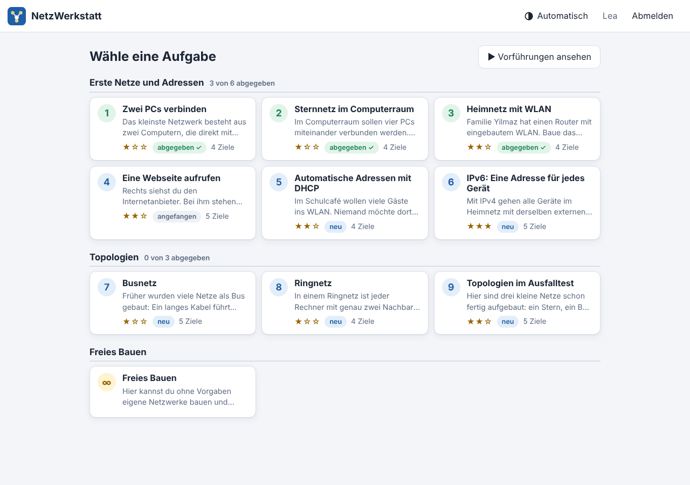
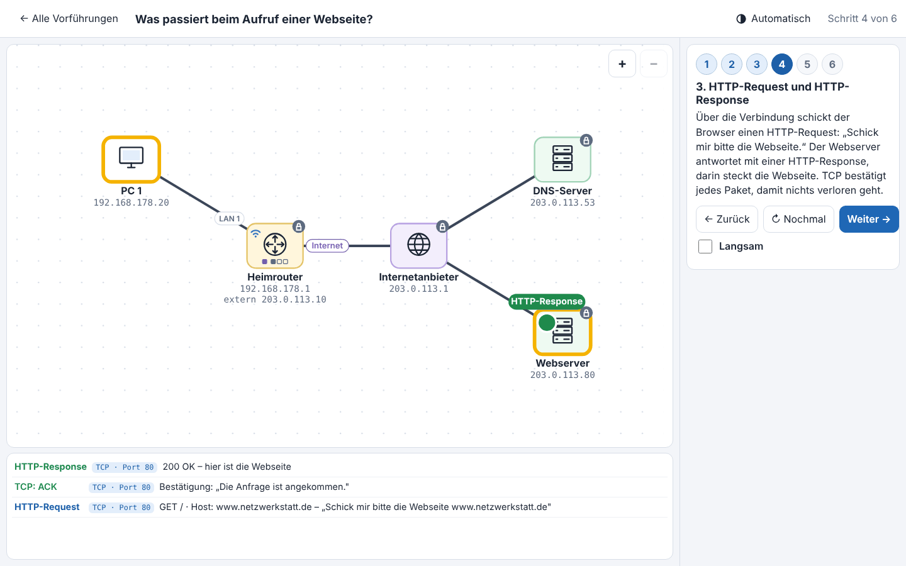
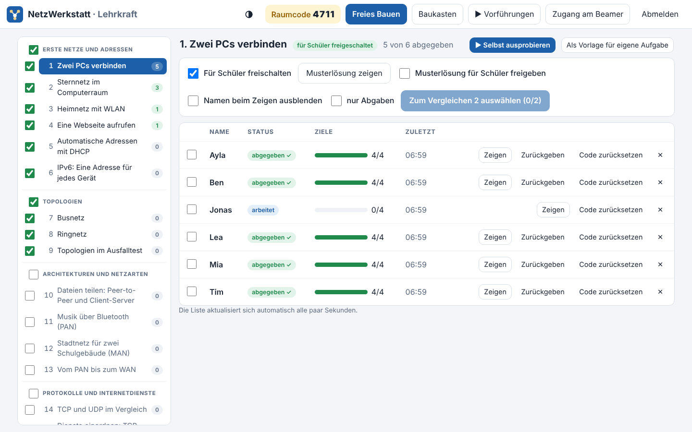
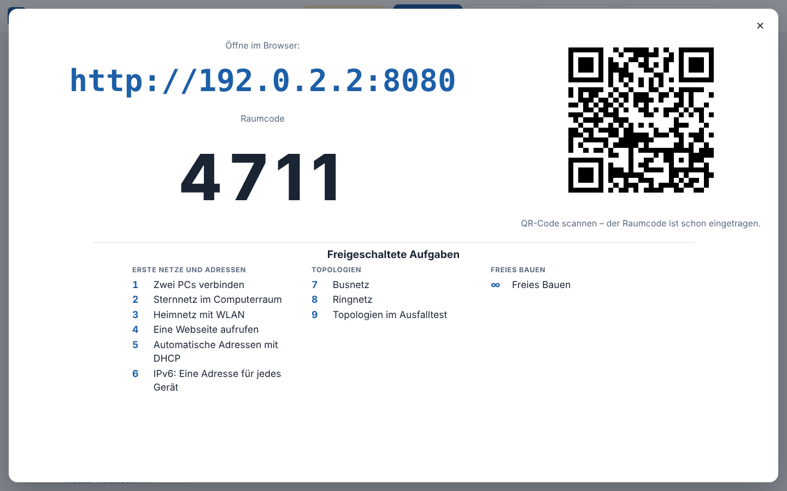

# NetzWerkstatt

**Ein Lernspiel, in dem Schülerinnen und Schüler Netzwerke selbst bauen und den Datenpaketen bei der Arbeit zuschauen.**

Die NetzWerkstatt ist für den Informatikunterricht der Sekundarstufe I gedacht. Sie ist bewusst einfach gehalten: Bauen und Testen passieren auf derselben Fläche, es gibt keine verschachtelten Fenster, und Fehler werden in verständlicher Sprache direkt am Paket erklärt.

Das Programm läuft auf dem Rechner der Lehrkraft (Windows, Linux oder Mac) und muss nicht installiert werden. Die Schülerinnen und Schüler brauchen nur einen Browser, am PC oder auf dem iPad.


*Bauen und Testen auf einer Fläche: Links die Aufgabe und die Einstellungen des angetippten Geräts, in der Mitte das Netz mit den laufenden Datenpaketen, darunter die Datenpakete (hier DNS-Anfrage, DNS-Antwort und HTTP-Request mit NAT), rechts die Geräteleiste.*

## Inhalt

**Für Lehrkräfte**

1. [Schnellstart](#schnellstart)
2. [Herunterladen und starten](#herunterladen-und-starten)
3. [Ablauf im Unterricht](#ablauf-im-unterricht)
4. [Wenn etwas nicht klappt](#wenn-etwas-nicht-klappt)
5. [Datenschutz](#datenschutz)
6. [Was die NetzWerkstatt kann](#was-die-netzwerkstatt-kann)
   - [Netze bauen und einstellen](#netze-bauen-und-einstellen)
   - [Internet, DNS und NAT](#internet-dns-und-nat)
   - [Dienste und Protokolle](#dienste-und-protokolle)
   - [Die Aufgaben](#die-aufgaben)
   - [Werkzeuge für die Lehrkraft](#werkzeuge-für-die-lehrkraft)
7. [Startoptionen für Fortgeschrittene](#startoptionen-für-fortgeschrittene)

**Für Entwicklerinnen und Entwickler**

8. [Entwicklung](#entwicklung)
9. [Lizenz](#lizenz)

## Schnellstart

1. Das Paket für den eigenen Rechner unter [**Releases**](https://github.com/Obi-Wahn/NetzWerkstatt/releases/latest) herunterladen und entpacken.
2. Das Programm starten. Die Lehrkraft-Ansicht öffnet sich von selbst im Browser.
3. „Zugang am Beamer“ anklicken. Die Klasse öffnet die angezeigte Adresse im Browser und meldet sich an.

Die einzelnen Schritte mit allen Hinweisen stehen im nächsten Abschnitt.

## Herunterladen und starten

Es muss nichts installiert werden.

1. Unter [**Releases**](https://github.com/Obi-Wahn/NetzWerkstatt/releases/latest) das passende Paket herunterladen:
   - Windows: `NetzWerkstatt-Windows.zip`
   - Linux: `NetzWerkstatt-Linux.tar.gz`
   - Mac (Apple-Chip und Intel): `NetzWerkstatt-Mac.zip`
2. Das Paket entpacken und den Ordner an einen festen Ort legen (z. B. „Dokumente“ oder USB-Stick). Nicht direkt aus der ZIP-Datei starten.
3. Starten: unter Windows Doppelklick auf `NetzWerkstatt.exe`, unter Linux `start.sh`, auf dem Mac `start.command`.
   - Windows zeigt beim ersten Start evtl. „Der Computer wurde durch Windows geschützt“ → „Weitere Informationen“ → „Trotzdem ausführen“. Die Frage nach dem Netzwerkzugriff mit „Zugriff zulassen“ beantworten.
   - Der Mac blockiert das Programm beim ersten Start, weil es nicht bei Apple registriert ist: Rechtsklick auf `start.command` → „Öffnen“ → „Öffnen“. Ab macOS 15 stattdessen unter Systemeinstellungen → „Datenschutz & Sicherheit“ auf „Dennoch öffnen“ klicken. Die genaue Anleitung steht in der LIESMICH.txt.
4. Das Programm prüft Speicherort, Port und Netzwerkverbindung selbst, meldet Probleme verständlich und öffnet danach die **Lehrkraft-Ansicht** im Browser – bereits angemeldet. Im Fenster mit den Startmeldungen stehen die Adresse für die Klasse, der Raumcode und das Lehrer-Passwort.
5. In der Lehrkraft-Ansicht „Zugang am Beamer“ wählen. Die Schülerinnen und Schüler öffnen die angezeigte Adresse im Browser (Edge, Chrome, Firefox oder Safari auf dem iPad) und melden sich mit Vornamen oder Kürzel, dem Raumcode und einem selbst ausgedachten vierstelligen Code an. Mit diesem Code kann sich niemand unter fremdem Namen anmelden.

Das Fenster mit den Startmeldungen während der Stunde offen lassen. Zum Beenden das Fenster schließen; alle Arbeiten bleiben gespeichert, beim nächsten Start geht es dort weiter.

## Ablauf im Unterricht

1. **Vorbereiten:** In der Lehrkraft-Ansicht links die Aufgaben für die Klasse freischalten. Ab Werk sind die Aufgaben 1–5 und das freie Bauen freigeschaltet. Mit „▶ Selbst ausprobieren“ lässt sich jede Aufgabe vorher selbst durchspielen, mit „Freies Bauen“ ein eigenes Netz bauen.
2. **Einführen:** Unter „▶ Vorführungen“ zeigen fertige Netze Schritt für Schritt, was passiert, z. B. beim Aufruf einer Webseite. Dort lassen sich einzelne Vorführungen auch für die Klasse freigeben, damit sie selbst nachschauen kann.
3. **Anmelden lassen:** Wer mehrere Klassen hat, schaltet oben die richtige Klasse aktiv. „Zugang am Beamer“ zeigt Adresse, Raumcode und QR-Code groß für die ganze Klasse.
4. **Arbeiten:** Jede Schülerin und jeder Schüler wählt eine Aufgabe und einen Schwierigkeitsgrad. Die Teilziele werden automatisch abgehakt. In der Lehrkraft-Ansicht erscheint live, wer woran arbeitet und wie viele Ziele schon erreicht sind.
5. **Besprechen:** Abgaben mit „Zeigen“ am Beamer vorstellen (auf Wunsch ohne Namen), zwei Lösungen nebeneinander vergleichen, die Musterlösung mit Lösungsweg zeigen oder für die Klasse freigeben, Abgaben zur Überarbeitung zurückgeben.

| Aufgaben auswählen | Vorführung am Beamer |
| --- | --- |
|  |  |
| Die Schülerinnen und Schüler sehen nur die freigeschalteten Aufgaben, nach Themen geordnet und mit ihrem eigenen Stand. | Fertige Netze, in denen Schritt für Schritt erklärt wird, was passiert. Mit „Weiter“ und „Zurück“ bestimmt man das Tempo. |

| Lehrkraft-Ansicht | Zugang am Beamer |
| --- | --- |
|  |  |
| Links werden Aufgaben freigeschaltet, rechts erscheint live, wer woran arbeitet und wie viele Ziele schon erreicht sind. | Adresse, Raumcode und QR-Code zum Anmelden, groß genug für die ganze Klasse. |

*Die Bilder zeigen Beispieldaten: Namen, Raumcode und Adressen sind ausgedacht.*

## Wenn etwas nicht klappt

- **Die Schüler-Geräte erreichen die Adresse nicht:** Sind alle Geräte im selben Netz (gleiches WLAN bzw. Schulnetz)? Wurde unter Windows bei der Frage nach dem Netzwerkzugriff „Zugriff zulassen“ gewählt? Manche Schulnetze trennen Schüler- und Lehrergeräte, dann hilft die Schul-IT.
- **Jemand hat den vierstelligen Code vergessen:** In der Lehrkraft-Ansicht bei der Person „Code zurücksetzen“ wählen. Beim nächsten Anmelden gilt dann der neu eingegebene Code.
- **Der Raumcode ist anders als beim letzten Mal:** Er wird bei jedem Start neu ausgewürfelt. Wer schon angemeldet ist, arbeitet trotzdem einfach weiter. Ein fester Raumcode lässt sich mit einer [Startoption](#startoptionen-für-fortgeschrittene) festlegen.
- **Das Programm wurde ein zweites Mal gestartet:** Dann öffnet es nur die Lehrkraft-Ansicht der bereits laufenden NetzWerkstatt.
- **Das Lehrer-Passwort ist vergessen:** Es steht im Fenster mit den Startmeldungen und bleibt gespeichert, bis es geändert wird. Ein neues lässt sich mit der Startoption `-passwort` festlegen.

## Datenschutz

- Alle Daten (Vornamen bzw. Kürzel und die gebauten Netzwerke) werden **nur auf dem Lehrer-Rechner** in der Datei `netzwerkstatt-daten.json` neben dem Programm gespeichert.
- Das Programm lädt **nichts aus dem Internet** und sendet nichts dorthin. Alle Schriften, Bilder und Skripte sind im Programm enthalten. Der Browser wird zusätzlich per Content-Security-Policy angewiesen, nur Inhalte vom eigenen Server zu laden.
- Es gibt keine E-Mail-Adressen für Schülerinnen und Schüler, nur einen vierstelligen Code (gespeichert wird nur ein Prüfwert, nicht der Code selbst), kein Tracking und keine Cookies. Im Browser wird nur ein Anmelde-Schlüssel gespeichert, damit man nach einem Neuladen angemeldet bleibt.
- Nach der Unterrichtseinheit kann die Datendatei einfach gelöscht werden. Einzelne Personen lassen sich auch in der Lehrkraft-Ansicht löschen.
- Eine heruntergeladene Sicherung („Daten sichern“) enthält die Namen der Schülerinnen und Schüler, aber nicht das Lehrer-Passwort. Sie sollte so sicher aufbewahrt werden wie andere Schülerdaten.

## Was die NetzWerkstatt kann

### Netze bauen und einstellen

- **Baukasten:** Die Geräteleiste (am PC und iPad quer rechts, auf dem iPad hochkant oben) ist nach Kategorien sortiert, die sich einklappen lassen: Endgeräte (PC, Laptop, Tablet, Smartphone, Kopfhörer), aktive Komponenten (Switch, Access Point, Router), Verbindungen als passive Komponenten (Netzwerkkabel, Glasfaser, WLAN, Bluetooth, Bus-Kabel), Server (leer oder als Web-, DNS-, Mail-, Video-, Telefonie- oder Spiele-Server) und Internet (Internetanbieter, Rechenzentrum). In Aufgaben erscheint nur, was gebraucht wird. Funktioniert mit Maus und Finger (Windows-PCs und iPads).
- **Anschlüsse:** Am Router und am Switch steht an jedem Kabel, in welchem Anschluss es steckt (WAN, LAN 1–3, Port 1–8). Belegte Buchsen sind im Gerät gefüllt.
- **Netzwerk-Einstellungen:** IP-Adresse (IPv4), Gateway und DNS-Server (die Subnetzmaske ist fest 255.255.255.0) mit sofortigen Hinweisen, z. B. „lokale (private) Adresse“ oder „Das Gateway muss im selben Netz liegen“. Beim Eintragen von Hand werden passende freie Adressen, der Router als Gateway und ein vorhandener DNS-Server vorgeschlagen.
- **Heimrouter:** Drei LAN-Anschlüsse und eingebautes WLAN bilden zusammen das Heimnetz (wie ein eingebauter Switch), dazu ein Internet-Anschluss (WAN) mit abschaltbarem eingebautem Modem. Ab Werk hat das Heimnetz eine freie Adresse (192.168.0.1, beim nächsten Router 192.168.1.1 …) und DHCP ist an. Kabel lassen sich zwischen LAN und WAN umstecken.
- **DHCP:** Neue Endgeräte stehen wie in echt auf „Automatisch (DHCP)“ und holen sich beim Verbinden selbst eine Adresse; in Aufgaben zum Eintragen von Hand ist DHCP aus. Der Ablauf Discover → Offer → Request → Ack wird animiert, Discover und Request gehen sichtbar „an alle“. Findet ein Gerät keinen DHCP-Server, gibt es sich eine Notfall-Adresse 169.254.x.x (APIPA) – so erreichen sich z. B. zwei direkt verbundene PCs.
- **IPv6:** Jedes Gerät hat automatisch eine Link-Local-Adresse (fe80::…), die nur im eigenen Netz gilt. Ist der Router mit einem Internetanbieter verbunden, bekommt er von ihm ein eigenes IPv6-Netz für das Heimnetz, und die Geräte bilden daraus selbst ihre globale Adresse (2001:db8:…, der für Beispiele reservierte Bereich). Ping funktioniert auch per IPv6 – ohne NAT, also auch aus dem Internet ins Heimnetz. Ein Umschalter zeigt auf der Arbeitsfläche wahlweise IPv4- oder IPv6-Adressen, und ein Vergleich erklärt die Unterschiede (Länge, Schreibweise, Anzahl, NAT).
- **Netzarten PAN, LAN, MAN, WAN:** Eine Anzeige auf der Arbeitsfläche erkennt, welche Netzarten im Aufbau stecken, und hebt beim Antippen die zugehörigen Geräte hervor. Bluetooth-Kopfhörer bilden mit dem Smartphone ein PAN, mit „Glasfaser“ aus der Geräteleiste (oder durch Antippen eines Kabels) entsteht eine Glasfaserleitung quer durch die Stadt (MAN), der Internetanbieter führt ins WAN.

### Internet, DNS und NAT

- **Internetanbieter und Internet:** Der Internetanbieter verteilt öffentliche (externe) Adressen per DHCP an angeschlossene Router und Server und gibt einen DNS-Server weiter, den der Heimrouter an das Heimnetz durchreicht. Mehrere verbundene Internetanbieter bilden zusammen das Internet. So lassen sich im freien Modus Webserver und DNS-Server ins Internet stellen und vom Heimnetz aus aufrufen.
- **Rechenzentren für Internetserver:** Ein Rechenzentrum hat ein eigenes öffentliches Netz (z. B. 198.51.100.0/24), getrennt von den Netzen der Internetanbieter. Server dort bekommen ihre Adresse per DHCP aus diesem Netz und sind über die Leitung zum Internetanbieter im ganzen Internet erreichbar. So entstehen mehrere Internetserver mit verschiedenen Diensten in verschiedenen Netzen.
- **Eigener DNS-Server und Weiterleitung:** Jeder Server kann DNS-Server sein. Kennt er einen Namen nicht, kann er ihn bei einem anderen DNS-Server erfragen (Weiterleitung). Der Heimrouter kann wie die meisten echten Router selbst DNS-Server sein: Er verteilt per DHCP seine eigene Adresse und leitet die Anfragen an den DNS-Server des Anbieters weiter. Das Protokoll zeigt jede DNS-Anfrage und -Antwort entlang der Kette.
- **NAT:** Pakete aus dem Heimnetz gehen mit der externen Adresse des Routers ins Internet; das Protokoll zeigt die Übersetzung hin und zurück. Lokale (private) Adressen werden im Internet nicht weitergeleitet, und Anfragen aus dem Internet kommen nicht ins Heimnetz.

### Dienste und Protokolle

- **Simulation mit Animation:** Ping (Anfrage und Antwort) sowie Webseiten-Aufruf mit DNS-Anfrage, DNS-Antwort, HTTP-Request und HTTP-Response. Router verbinden verschiedene Netze, Switches und Access Points leiten innerhalb eines Netzes weiter.
- **TCP und UDP:** Auf Wunsch zeigt die Animation bei TCP den Verbindungsaufbau (SYN, SYN-ACK, ACK), die Bestätigungen und den Verbindungsabbau. Jede Verbindung lässt sich auf „gestört“ stellen: Dann geht ein Paket verloren. TCP wartet vergeblich auf die Bestätigung und sendet neu, bei UDP bleibt das Paket verloren (Bild ruckelt kurz).
- **Dienste auf Servern:** Webserver mit eigener Seite, DNS-Server mit eigenen Einträgen, Dateiablage (Cloud-Speicher), E-Mail-Server (Senden per SMTP, Abrufen per IMAP), Video-Streaming, Video- und Audio-Telefonie und Spiele-Server. Zu jedem dieser Internetdienste stehen Protokoll, Port und eine kurze Begründung, warum er TCP oder UDP nutzt. Beim Server lässt sich für jeden Dienst ein Name im Internet eintragen (z. B. `www.meineseite.de`) und per Knopfdruck bei einem DNS-Server anmelden. Der Browser schickt den Namen im HTTP-Request mit, und ein Webserver mit anderem Namen antwortet mit „404 Not Found“.
- **Peer-to-Peer und Client-Server:** Endgeräte tauschen Dateien direkt miteinander (Peer-to-Peer, jedes Gerät ist Client und Server zugleich) oder laden sie auf einen Server hoch und holen sie dort ab (Client-Server). Das Protokoll erklärt jeweils, wer Client und wer Server ist.

### Die Aufgaben

Alle Aufgaben haben Teilziele, die automatisch abgehakt werden, sobald sie erreicht sind.

1. Zwei PCs verbinden
2. Sternnetz im Computerraum
3. Heimnetz mit WLAN
4. Eine Webseite aufrufen (DNS, Router, lokale und externe IP-Adresse)
5. Automatische Adressen mit DHCP
6. IPv6: Eine Adresse für jedes Gerät
7. Busnetz
8. Ringnetz
9. Topologien im Ausfalltest
10. Dateien teilen: Peer-to-Peer und Client-Server
11. Musik über Bluetooth (PAN)
12. Stadtnetz für zwei Schulgebäude (MAN)
13. Vom PAN bis zum WAN
14. TCP und UDP im Vergleich (Video-Streaming und Videoanruf über eine gestörte WLAN-Verbindung)
15. Dienste einordnen: TCP oder UDP? (Dienste ausprobieren und Anwendungen zuordnen)
16. Eigene Internetdienste anbieten (E-Mail-Server und Spiele-Server mit DNS-Namen)
17. Fehlersuche im Computerraum
18. Fehlersuche im Heimnetz
19. Fehlersuche: Das Internet geht nicht
20. Freies Bauen

- **Schwierigkeitsgrade:** Jede Aufgabe lässt sich auf „Leicht“ (Tipp offen, Hinweis zum nächsten Schritt), „Mittel“ oder „Schwer“ (ohne Tipp und ohne Vorschläge) stellen. Die Schülerinnen und Schüler wählen selbst; die Lehrkraft sieht die gewählte Stufe in ihrer Übersicht.
- **Fehler im Netzwerk finden:** In den Fehlersuche-Aufgaben steckt ein Kabel nicht richtig, ein Kabel ist kaputt (das zeigt erst der Kabeltester) oder bei einem Gerät ist das WLAN aus. Ping und Webseite verraten nur, zwischen welchen Geräten kein Signal ankommt. Im freien Bauen lassen sich solche Fehler auch selbst einbauen, z. B. für eigene Aufgaben.
- **Neu anfangen:** Eine Aufgabe lässt sich nach einer Sicherheitsabfrage auf den Anfang zurücksetzen; direkt danach kann man das noch rückgängig machen.

### Werkzeuge für die Lehrkraft

- **Lehrkraft-Ansicht:** Live-Übersicht über alle Schülerinnen und Schüler, Abgaben am Beamer zeigen (auf Wunsch ohne Namen), zwei Lösungen nebeneinander vergleichen, jede Lösung genau ansehen (Ziele, Einstellungen, durchgeführte Tests), Musterlösungen mit Lösungsweg zeigen oder für die Klasse freigeben, Abgaben zurückgeben.
- **Klassen:** Unter „Klassen verwalten“ legt die Lehrkraft Klassen an (z. B. 10a, 10b) und schaltet eine davon aktiv. Wer sich anmeldet, landet automatisch in der aktiven Klasse. Oben in der Lehrkraft-Ansicht wählt man, welche Klasse angezeigt wird; so bleiben Abgaben der Klassen getrennt. Wird eine andere Klasse aktiv geschaltet, sind die Schüler der bisherigen Klasse abgemeldet (ihre Arbeiten bleiben gespeichert) – an geteilten Rechnern arbeitet so niemand im Konto eines anderen weiter. Wer in der falschen Klasse gelandet ist, lässt sich mit „⇄ Klasse“ verschieben.
- **Daten sichern:** Mit „Daten sichern“ lädt die Lehrkraft alles als eine Datei herunter: Klassen, Schülerinnen und Schüler, Arbeiten, Freischaltungen, Freigaben und eigene Aufgaben. Aus dieser Datei lässt sich der Stand später wiederherstellen, auch auf einem anderen Rechner. Raumcode und Lehrer-Passwort bleiben dabei, wie sie sind. Vor dem Wiederherstellen legt das Programm den bisherigen Stand als Datei neben die Datendatei.
- **Aufgaben freischalten:** Die Lehrkraft bestimmt, welche Aufgaben und Themen (auch das freie Bauen) die Klasse sieht. Änderungen erscheinen bei den Schülern sofort, ohne Neuladen. Ab Werk sind die Aufgaben 1–5 und das freie Bauen freigeschaltet. Mit angelegten Klassen hat jede Klasse ihre eigenen Freischaltungen für Aufgaben, Musterlösungen und Vorführungen; sie gelten für die oben gewählte Klasse. Eine neue Klasse beginnt wie ab Werk oder übernimmt die Freischaltungen einer anderen Klasse.
- **Vorführungen:** Fertige Netze, in denen Schritt für Schritt erklärt wird, was passiert (Webseite aufrufen, NAT, DHCP, Gateway, Topologien, TCP und UDP) – zum Vorführen am Beamer oder zum Nachschauen. Am Ende geht es direkt zur passenden Aufgabe.
- **Eigene Aufgaben:** Im Aufgaben-Editor der Lehrkraft-Ansicht entstehen eigene Aufgaben aus Text, automatisch geprüften Zielen, Startaufbau und Musterlösung. Start und Musterlösung baut die Lehrkraft im „Baukasten“ (Schüleransicht mit allen Aufgaben) oder übernimmt sie aus einer Schülerarbeit oder einer eingebauten Aufgabe. Eigene Aufgaben lassen sich als Datei exportieren und bei anderen Lehrkräften importieren. Importierte Dateien werden genau geprüft; sie enthalten keinen Programmcode.

## Startoptionen für Fortgeschrittene

Das Programm lässt sich auch über die Kommandozeile mit Optionen starten:

```
NetzWerkstatt.exe -port 8080 -raumcode 1234 -passwort geheim -daten pfad/zur/datei.json -kein-browser
```

| Option | Wirkung |
| --- | --- |
| `-port` | Port, unter dem die NetzWerkstatt erreichbar ist (Standard: 8080) |
| `-raumcode` | fester Raumcode statt eines neu ausgewürfelten |
| `-passwort` | neues Lehrer-Passwort festlegen |
| `-daten` | anderer Speicherort für die Datendatei |
| `-kein-browser` | den Browser beim Start nicht öffnen |

## Entwicklung

Voraussetzung: [Go](https://go.dev) ab Version 1.24 und für die Tests [Node.js](https://nodejs.org).

Unter Linux lassen sich beide über die Paketverwaltung installieren, z. B. `sudo dnf install golang nodejs` (Fedora) oder `sudo apt install golang-go nodejs` (Debian/Ubuntu). Mit `go version` prüfen, ob die Go-Version neu genug ist.

```
go run .                      # Server lokal starten
node test/simulation.test.js  # Tests für Simulation und Aufgaben
./build.sh v0.2.0             # Download-Pakete für Windows, Linux und Mac in dist/ erzeugen
```

Auf einem Windows-Rechner genügt zum Bauen auch `go build -o NetzWerkstatt.exe .`, unter Linux `go build -o netzwerkstatt .`

### Neue Version veröffentlichen

Auf GitHub unter Releases → „Draft a new release“ einen neuen Tag wie `v0.2.0` anlegen und veröffentlichen. GitHub baut die Pakete dann automatisch und hängt sie an das Release an.

### Aufbau des Codes

| Datei | Inhalt |
| --- | --- |
| `start.go` | Start: Prüfungen, Meldungen, Browser öffnen |
| `main.go` | Server: Anmeldung, Speichern, Lehrkraft-Schnittstelle, Auslieferung der Webseiten |
| `backup.go` | Sicherung herunterladen und wiederherstellen |
| `paket/` | Anleitungen und Startskript für die Download-Pakete |
| `web/js/sim.js` | Netzwerkmodell und Simulation (Weg der Pakete, DNS, HTTP) |
| `web/js/tasks.js` | Aufgaben, Teilziele und Musterlösungen |
| `web/js/loesungen.js` | Lösungswege zu den Musterlösungen |
| `web/js/eigene.js` | Eigene Aufgaben: Dateiformat, Prüfung beim Import, Ziel-Bausteine |
| `web/js/view.js` | Darstellung des Netzwerks und Paketanimation |
| `web/js/app.js` | Oberfläche für Schülerinnen und Schüler |
| `web/js/teacher.js` | Lehrkraft-Ansicht |

Neue Aufgaben werden in `web/js/tasks.js` ergänzt, ihr Lösungsweg in `web/js/loesungen.js`. Der Test prüft automatisch, dass jede Musterlösung alle Teilziele erfüllt und jede Aufgabe einen Lösungsweg hat.

## Lizenz

MIT – siehe [LICENSE](LICENSE).
